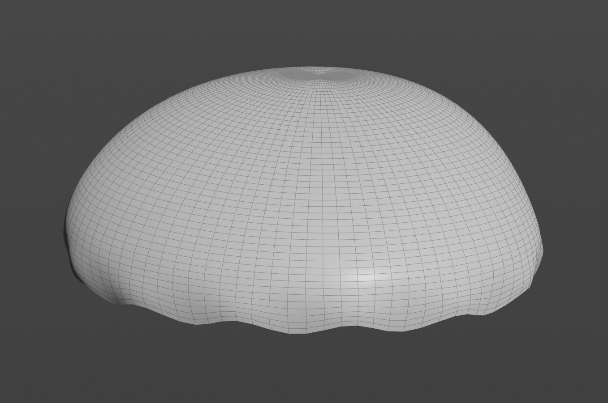
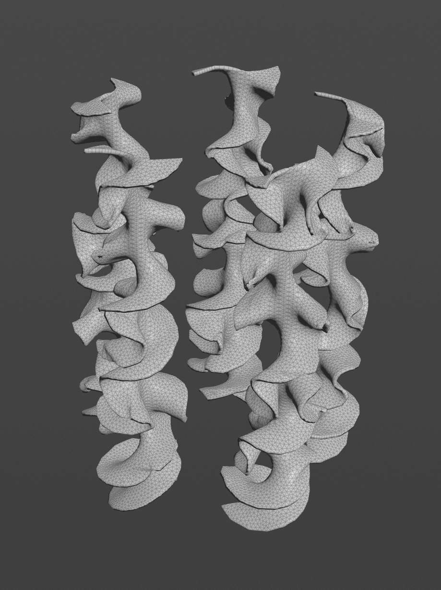
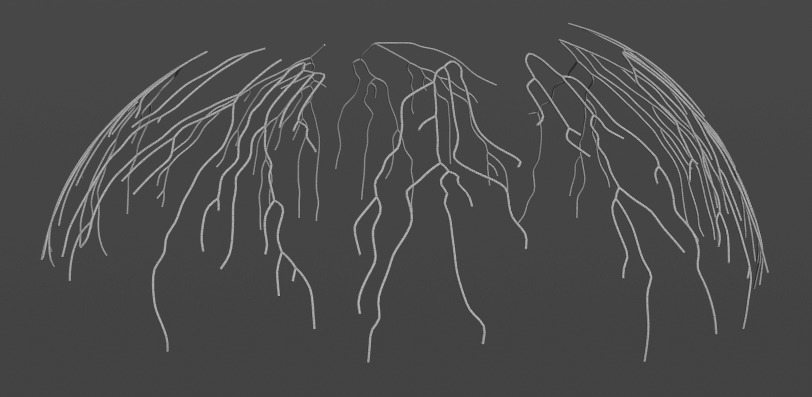
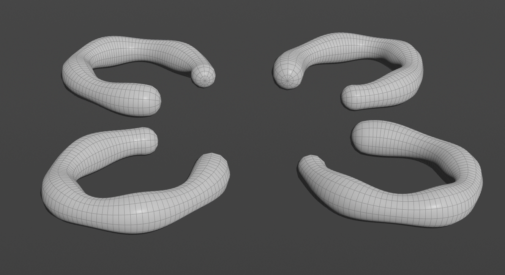
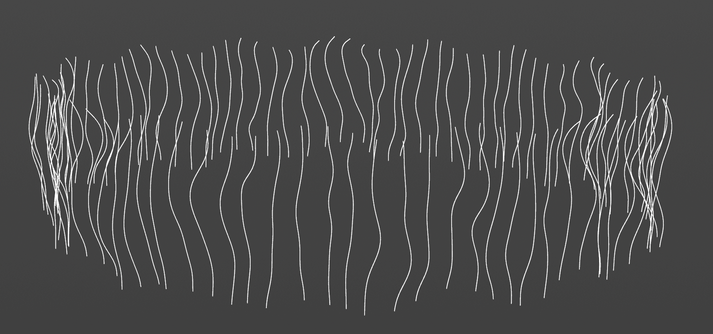

# Procedural Jellyfish

For this project, I made a procedural jellyfish in Houdini with an animated bell, simulated arms and tentacles, branching veins, and four curved organs. 

## Animation

https://github.com/user-attachments/assets/819a0003-bf7d-4dee-a974-5649321498c0

## Parts

| Part | Preview |
| --- | --- |
| **Bell** — A revolved profile with a pulsing animation and a wavy lower edge. |  |
| **Arms** — Twisted surfaces simulated with Vellum and pinned at their roots. |  |
| **Veins** — Branching curves made with Find Shortest Path, smoothed, and thickened with Sweep. |  |
| **Organs** — Four horseshoe-shaped tubes with some variation in shape and thickness. |  |
| **Tentacles** — Lines distributed around the bell's rim, simulated with Vellum Hair and POP Force. |  |

## Extra Credit

I added a scalloped edge to the bell using a sine wave in VEX. The effect fades out toward the top, so the lower edge has more detail while the main bell keeps its original shape.
